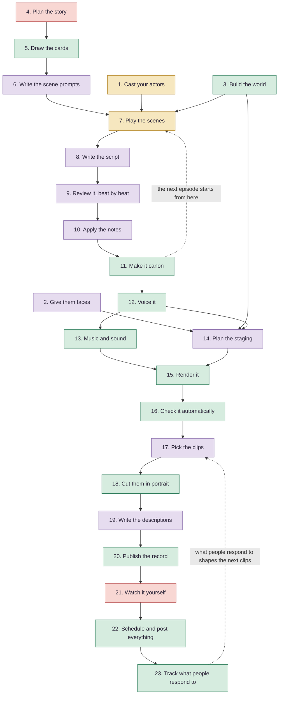

# How to Make Your Own AI, Procedurally Generated Show

A full content pipeline, from the first idea to the posted episode. This is the model I use, and it's free. Take it, change it, and make something of your own.

## The idea: AI reality TV

The usual way to make an AI show is to have a model write a script from character sheets. This works the other way round. You cast roleplay characters, put them in a room together, and let them live the scene. The script comes afterward, from what really happened.

That matters because a model writing alone tends to sound flat. A roleplay character reacts, remembers and surprises you, and what happens to them stays with them, the way it does for a reality TV cast. The rest of the machine turns that into a show.

- **Programs do whatever repeats the same way every time.**
- **Models do whatever takes judgment.**
- **You get the first watch of every finished episode.**

The whole process can be automated if you want to take it that far. Where a step needs a decision, a model can make it. Where a step repeats, a script can run it.

The tools named under each step are the ones I use. Swap any of them for what you have.

## The flow

Follow the arrows down. Each step needs the one before it. The colors show who does the work, and the numbers match the steps below.

Red is you, gold is the AI actors, purple is models, and green is programs.

## The steps

### Once, before the first episode

**1. Cast your actors.** Create the characters as AI companions, each with a history, habits and friendships. Ask them whether they want to take part, and let them say no.
- Tools: Kindroid
- For yours: use any companion app with an official API, and read its terms first.

**2. Give them faces.** Make a look for each character, then portraits for each feeling and pixel sprites from one shared paper-doll body, so everyone stays on model.
- Tools: ChatGPT, Hello Haven, hand-coded sprite tools
- For yours: build one good body first, and reuse it.

**3. Build the world.** Make each location once as a set template, and a chat room for each one that holds what stays true of that place.
- Tools: Blender, Godot, Kindroid group chats
- For yours: script your sets, so a tweak never means starting over.

**4. Plan the story.** Decide where the story is going and plan the seasons, down to what happens in each episode.
- Tools: you, Claude
- For yours: know your ending first, and the middle gets easier.

### Every episode

**5. Draw the cards.** A program draws cards to set each scene's beats. I use tarot and Lenormand. The chance keeps a model from always picking the obvious thing.
- Tools: a small card-drawing program
- For yours: dice or a random table work too. The program does the random part, never the model.

**6. Write the scene prompts.** A model turns each draw into plain direction for a Narrator, who sets the scene.
- Tools: Claude
- For yours: keep the deck out of the prompt. The actors only need the scene.

**7. Play the scenes.** The characters play each scene once, in story order. It is kept whatever happens, like reality TV, because everything that happens to them changes them a little.
- Tools: Kindroid, a small desktop program, Python
- For yours: a short script that sends each line through the API and saves every reply will do.

**8. Write the script.** A writing model turns what happened into a script. It keeps the best dialogue and remixes the rest.
- Tools: Gemini
- For yours: always give it the real scene to work from.

**9. Review it, beat by beat.** Other models read the script and say what they thought at each beat. A model that didn't write it catches what the writer missed.
- Tools: Hello Haven, local models
- For yours: use at least one model that had no part in the writing.

**10. Apply the notes.** A model makes the changes that matter and sets the script.
- Tools: Claude
- For yours: keep the notes, even the ones you don't use. They are good material.

**11. Make it canon.** The finished script becomes what really happened, and the actors are updated. The next episode starts from here, so the story builds on itself.
- Tools: a program, Kindroid
- For yours: keep one record of what is true. Soaps depend on it.

**12. Voice it.** Each character has a voice designed for them, and every line comes back with each word timed. Those timings drive what appears on screen. ElevenLabs is the hosted option, and local models like Chatterbox mean a daily show doesn't depend on credits alone.
- Tools: ElevenLabs, Chatterbox running locally, other local voice models
- For yours: test three sample lines first. And voice a few extra words after each line, then cut them away, so the last word ends naturally.

**13. Music and sound.** Original music and sound effects, written in code, are mixed under the voices.
- Tools: FluidSynth, ffmpeg, Ardour
- For yours: measure your sounds and listen to them too. Numbers can pass a sound that still sounds wrong.

**14. Plan the staging.** A cue sheet says who speaks, when, where they stand and which face they show, using the art from steps 2 and 3.
- Tools: Claude, Python
- For yours: if every moment lives in one list, you can rebuild the whole episode from it.

**15. Render it.** Godot stages the cue sheet like a toy theater and renders the episode.
- Tools: Godot, ffmpeg
- For yours: run heavy renders overnight, so your computer is yours by day.

**16. Check it automatically.** Scripts check the loudness, long silences, and whether sounds land on top of speech. A privacy scan reads everything before it goes public.
- Tools: Python, Node.js, ffmpeg
- For yours: each time you catch a mistake by hand, turn it into a check.

### Alongside every episode: the promotion

None of this is a separate project. Every decision here gets made as the main episode is created, from the same material, so the whole week's content is ready when the episode is.

**17. Pick the clips.** A model reviews the finished episode for moments to use as promo teasers and as the week's shorts.
- Tools: Gemini
- For yours: decide how many pieces you want a week, and which platforms. Your interruptions, cliffhangers and one-liners are the best material.

**18. Cut them in portrait.** Each piece is generated in portrait instead of landscape, from the same cue sheet, so it is framed for a phone and not just cropped. The thumbnail is made here too.
- Tools: Godot, ffmpeg, Pillow
- For yours: since the cue sheet holds every moment, a new format is a new render, not a new edit.

**19. Write the descriptions.** A model writes the episode's listing and chapters, and a recommended description for every piece. Each description is saved with its piece, so nothing has to be written at posting time.
- Tools: Claude
- For yours: give the model your last few posts, so it keeps your voice.

**20. Publish the record.** Each episode gets a public text record: the transcript, the timings, and a count of every edit.
- Tools: GitHub
- For yours: this is optional, but saying plainly how AI was used builds trust.

**21. Watch it yourself.** Watch every episode before it posts. It's the joy of seeing it first, and it's your QA review.
- Tools: your own eyes and ears
- For yours: keep this step, however much you automate.

**22. Schedule and post everything.** A paid posting tool takes the episode, the shorts and their saved descriptions, and schedules them across your platforms.
- Tools: YouTube, a paid posting tool
- For yours: check that the tool uses each platform's official route, and check each platform's rules on labeling AI content.

**23. Track what people respond to.** Mark every promo with what it tried: the kind of clip, its length, its hook. Then read back who clicked, where they stopped watching, and what they did next. That shapes the next round of clips, and over time it shows you your formula.
- Tools: YouTube's analytics, a small tracking program
- For yours: one video isn't a formula. Compare like with like, and change one thing at a time.

## You don't have to code

I don't write code myself. Claude Code sessions wrote my tools under my direction. Describe what you want, watch what comes back, and give notes. Build every note into the tools, so you never have to give it twice.

## How AI was used

This guide was drafted with Claude (Anthropic) under my direction. The tools named in it are the ones my process uses: Kindroid, ChatGPT, Hello Haven, Gemini, Claude and ElevenLabs.

## See what I make with it

- [The show on YouTube](https://www.youtube.com/@SwingLightStyle)
- [The show's public records](https://github.com/swinglightstyle/ai-hourglass-lives-meet-the-cast)
- [My website](https://swinglightstyle.com)
- [My research](https://orcid.org/0009-0009-3669-7659)
